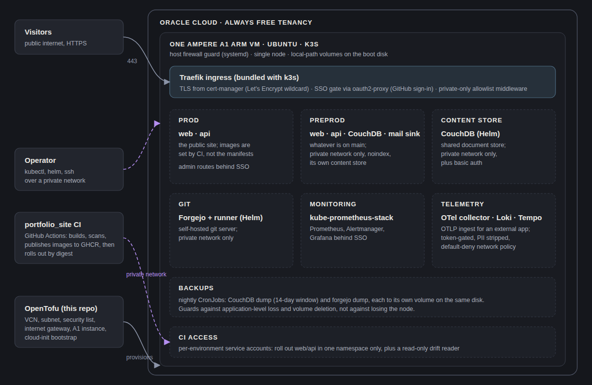

# oci-free

**A small, complete k3s platform on one Oracle Cloud Always Free ARM VM:
OpenTofu for the cloud side, plain manifests and pinned Helm charts for
everything on it, and CI that checks all of it.**

[](https://github.com/YehudaBriskman/oci-free/actions/workflows/ci.yml)
[](LICENSE)

**[Notes on how it is built](https://yehudabriskman.com/blog/area/oci-free)** ·
**[Manual](docs/README.md)** ·
**[The site it hosts](https://yehudabriskman.com)**



## What it is

The infrastructure behind [yehudabriskman.com](https://yehudabriskman.com) and
a handful of personal services, run for zero dollars on Oracle Cloud's Always
Free tier:

- **one Ampere A1 ARM VM** (2 OCPU, 12 GB), created by OpenTofu with a VCN,
  subnet and a security list that is closed by default;
- **k3s** on it, with Traefik as the ingress, cert-manager for TLS, and a
  sign-on proxy (GitHub sign-in) in front of the admin surfaces;
- **the site** in two namespaces, `prod` and `preprod`, rolled out by the site
  repository's CI;
- **platform services**: a Forgejo git server, a CouchDB,
  kube-prometheus-stack with Grafana, and an OpenTelemetry, Loki and Tempo
  stack for an external app's telemetry;
- **nightly backups** of the CouchDB and Forgejo data.

Administration (SSH and the Kubernetes API) is reached over a private network
and never exposed to the internet.

> **Never upgrade the tenancy to Pay-As-You-Go.** Always Free is a hard billing
> wall: without an explicit upgrade the account cannot be charged, and requests
> beyond the free envelope simply fail.

## Stack

| Layer | Built with |
|---|---|
| Cloud | Oracle Cloud Always Free, OpenTofu with the `oracle/oci` provider |
| Node | Ubuntu 24.04 (ARM), cloud-init, a systemd host firewall guard |
| Cluster | k3s, Traefik, cert-manager (Let's Encrypt), oauth2-proxy |
| Services | Forgejo, CouchDB, kube-prometheus-stack, OpenTelemetry Collector, Loki, Tempo |
| CI | GitHub Actions: gitleaks, shellcheck, kubeconform, Helm render, `tofu validate`, a telemetry end-to-end test |

## Layout

```
*.tf, cloud-init.yaml   OpenTofu: network, the A1 instance, its first-boot bootstrap
k8s/                    manifests, Helm values and the scripts that apply them
node/                   the host firewall guard and its systemd unit
tests/                  the checks CI runs, runnable locally
docs/                   the manual
```

## How it is built and deployed

```
tofu apply ──▶ VCN + subnet + security list + A1 instance ──▶ cloud-init bootstrap
install k3s ──▶ kubectl apply -f k8s/ ──▶ Helm releases at pinned versions
site CI    ──▶ main: roll preprod onto new digests   tag: roll prod onto released digests
```

The site's manifests carry no image: its CI owns that field, so applying them
never reverts a deployed release. CI gets one narrowly scoped credential per
environment. Details: [Deploy](docs/deploy.md).

## Manual

- [Infrastructure](docs/infrastructure.md): what OpenTofu creates, the free
  envelope, the network, the bootstrap
- [Kubernetes](docs/kubernetes.md): every file in `k8s/`, pinned Helm
  releases, rebuilding the cluster
- [Deploy](docs/deploy.md): the rollout scripts and CI's access
- [Backups](docs/backups.md): what is backed up, when, and its limits

## Rebuild

```sh
tofu init && tofu apply          # instance + network
kubectl apply -f k8s/            # after k3s install and kubeconfig merge
./k8s/portfolio-apply.sh prod    # web/api: the apply above cannot create them
./k8s/portfolio-apply.sh preprod
```

Then the Helm releases below, each at its recorded `--version`. Secrets
(`terraform.tfvars` and the rest) are gitignored and are recreated by hand.

## Helm releases

Every install or upgrade names the version, so an upgrade is a decision and not
a side effect of `helm repo update`. CI renders each values file against
exactly these versions (`tests/helm.sh`, which also pins each chart archive's
sha256). Bump a version by changing this table in the same commit as the
upgrade.

| Release | Namespace | Chart (name-version) | App version | Repository | Values |
|---|---|---|---|---|---|
| `kube-prometheus-stack` | `monitoring` | `kube-prometheus-stack-89.2.2` | v0.93.1 | `https://prometheus-community.github.io/helm-charts` | `k8s/monitoring-values.yaml` |
| `forgejo` | `forgejo` | `forgejo-17.1.5` | 15.0.7 | `oci://code.forgejo.org/forgejo-helm/forgejo` | `k8s/forgejo-values.yaml` |
| `couchdb` | `obsidian` | `couchdb-4.6.3` | 3.5.1 | `https://apache.github.io/couchdb-helm` | `k8s/couchdb-values.yaml` |
| cert-manager | | v1.21.1 | v1.21.1 | | none |

```sh
helm upgrade --install <release> <repo>/<chart> -n <namespace> \
  -f k8s/<values>.yaml --version <version from the table>
```

cert-manager has no values file here (its chart is `cert-manager` v1.21.1 at
`https://charts.jetstack.io` if it is reinstalled with Helm); its kinds are
schema-checked by `tests/manifests.sh`. Traefik is not in the table: k3s
installs it, so its version follows k3s.

## CI and tests

`.github/workflows/ci.yml` runs on every pull request and push to `main`. The
`CI gate` check is required on `main`; it fails if any job failed, and passes
over a job skipped only because the change did not touch its paths.

| Job | What it holds | Run it locally |
|---|---|---|
| Secrets | no credential in the commits a PR or push adds (gitleaks); weekly full history in `secret-scan.yml` | `.github/scripts/secret-scan.sh install`, then `MODE=full` `scan` |
| Shell | shellcheck over every script | `.github/scripts/tools.sh install shellcheck` |
| Manifests | `k8s/*.yaml` schema-valid, strict, with pinned CRD schemas | `tests/manifests.sh` |
| Helm | each values file renders at the version in the table above | `tests/helm.sh` |
| OpenTofu | `fmt -check`, `validate` against the locked provider | `tofu init -backend=false && tofu validate` |
| Telemetry e2e | the token gate, PII stripping and alert paging, from the deployed configs in Docker | `tests/telemetry-e2e.sh` |
| Scripts | wrong-context guard, image migration, secrets kept off argv, with a stub `kubectl` | `tests/scripts.sh` |

Tools are pinned with checksums in `.github/scripts/tools.sh`. Helm, OpenTofu
and the telemetry e2e run only when their files change
(`.github/scripts/ci-classify.sh`).

## Contributing

This is a personal project: **issues are welcome, pull requests are by
invitation.** Open an issue first; if a change makes sense you will be asked
for a PR there. See [CONTRIBUTING](.github/CONTRIBUTING.md) and the
[Code of Conduct](.github/CODE_OF_CONDUCT.md). Report security problems,
including a credential you think was committed, privately, as described in the
[security policy](.github/SECURITY.md).

## Licence

[MIT](LICENSE).
